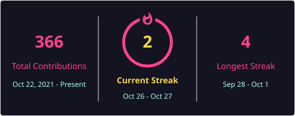

<h1 align="center">Olá! 👋 Eu sou Guilherme Franco</h1>

Full Stack Developer | Node.js, NestJS, React, React Native, PostgreSQL | francosys.com.br

## Sobre mim

Sou Guilherme Franco, desenvolvedor Full Stack e designer em Ituiutaba, MG. Crio aplicações web e mobile, APIs e automações com atenção à usabilidade e às necessidades de cada negócio.

Atuo como analista de sistemas e desenvolvedor Full Stack desde **2015**, com formação em **Engenharia da Computação pela UEMG** e formação contínua em desenvolvimento full stack pela **OneBitCode**.

Na **[FrancoSys](https://francosys.com.br/)**, trabalho com desenvolvimento de software e interfaces. Meu foco é conectar uma boa experiência de uso a soluções que simplificam o dia a dia.

Já entreguei projetos para construção civil, contabilidade, engenharia e organizações religiosas, de APIs de integração e bots de automação a plataformas SaaS completas.

### ⭐ Projeto em destaque: SêFranco

Plataforma SaaS multi-tenant de gestão de ativos e patrimônio, com dashboard web, app mobile com leitura de QR Code para auditoria de inventário e cálculo automático de depreciação.

**Stack:** React, Vite e Tailwind CSS no web; NestJS, Prisma e PostgreSQL no backend; React Native/Expo no mobile.

### 💻 O que eu faço

- Desenvolvimento de aplicações web responsivas e aplicativos mobile.
- Construção de backends, APIs e integrações.
- Automação de processos e desenvolvimento de sistemas de gestão.
- Design de interfaces com foco em experiência do usuário.

### 🛠️ Tecnologias

| Área | Stack |
| --- | --- |
| Frontend | JavaScript, TypeScript, React, Next.js, Tailwind CSS |
| Mobile | React Native |
| Backend | Node.js, NestJS, Express, Python |
| Dados | PostgreSQL, MongoDB |
| Ferramentas | Git, Docker, AWS, Figma |

### 🚀 Sistemas na FrancoSys

- **FrancoSys OS:** ordens de serviço para assistências técnicas.
- **Church ERP:** gestão de membros e finanças de igrejas.
- **FrancoSys DP:** rotinas de departamento pessoal.
- **ControlNs:** gestão de obras com operação em campo offline.
- **SSMA System:** inspeções de segurança do trabalho.
- **Extrator de Solicitações:** automação da extração de solicitações do PART da Cemig para Excel.

Conheça os sistemas e serviços no **[meu portfólio](https://francosys.com.br/)**.

### 🤝 Vamos conversar

[LinkedIn](https://www.linkedin.com/in/oguuiholiv/) · [FrancoSys](https://francosys.com.br/) · [E-mail](mailto:contato@francosys.com.br)

📍 ituiutaba

🔗 [GitHub](https://github.com/ooguuiholiv)

<a href="https://www.linkedin.com/in/oguuiholiv/">Meu site / contato</a>

## Projetos

## Estatísticas do GitHub

 

 

 

 

## Contribuições

<picture>
<source media="(prefers-color-scheme: dark)" srcset="./profile/snake-dark.svg" />

</picture>

---

Perfil sincronizado automaticamente com [@ooguuiholiv](https://github.com/ooguuiholiv).
